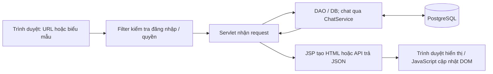

# Sportify - Đặt Sân, Quản Lý Sân & Cộng Đồng

Dự án Web Java Servlet/JSP (Java 17+, Servlet 6.1, Apache Tomcat 11, PostgreSQL).
Tập trung vào **đặt sân**, **quản lý sân**, **tự xác nhận đơn**, **chat trực tiếp chủ sân–khách hàng** và **mạng xã hội Newsfeed**. Lịch nhắc cá nhân được giữ riêng với đơn giữ chỗ.

Thuê gear, trang phục và PT đã tắt ở giao diện và máy chủ. Dữ liệu cũ được giữ lại; API chat dịch vụ mẫu trả HTTP 410, chat giữa các tài khoản vẫn hoạt động. Xem mô tả đầy đủ tại [TINH_NANG_WEBSITE.md](TINH_NANG_WEBSITE.md).

Tra cứu khi ôn vấn đáp:

- [Cấu trúc thư mục](#cau-truc-du-an): biết mã nguồn, giao diện, cấu hình và dữ liệu nằm ở đâu.
- [Bản đồ mã nguồn](#ban-do-ma-nguon): từ chức năng trên màn hình tìm đến Servlet, lớp dữ liệu và JSP.
- [Luồng xử lý thực tế](#luong-xu-ly): lần theo đăng nhập, đặt sân, duyệt đơn và chat.
- [Câu hỏi → vị trí cần chỉ](#tra-cuu-van-dap): tìm đúng hàm để giải thích với giảng viên.
- [Những điểm dễ nhầm](#diem-de-nham): phân biệt chức năng hiện tại, mã cũ và phần chưa triển khai.
- [Danh sách URL](#danh-sach-url) và [cách chạy dự án](#cai-dat-va-chay).

---

<a id="cau-truc-du-an"></a>

## Cấu trúc dự án

```text
Sportify/
├── database/                         # Script PostgreSQL, script và backup SQL Server
├── src/main/java/com/sportify/
│   ├── config/                       # DatabaseConfig, DBContext, AppLifecycle
│   ├── controller/                   # Servlet quản lý sân, đơn, lịch, đánh giá, thông báo
│   │   ├── auth/                     # LoginServlet, RegisterServlet, LogoutServlet
│   │   ├── home/                     # HomeServlet: tổng quan khách hàng
│   │   ├── appointment/              # AppointmentServlet: lịch nhắc cá nhân
│   │   ├── booking/                  # FieldBookingServlet, AvailabilityApiServlet
│   │   ├── chat/                     # ChatPageServlet, ChatApiServlet
│   │   ├── newsfeed/                 # NewsfeedPageServlet, NewsfeedApiServlet
│   │   └── profile/                  # ProfileServlet: xem và lưu hồ sơ
│   ├── dao/                          # Truy vấn JDBC
│   ├── data/                         # Chủ yếu JPA/Hibernate; có lớp dùng JDBC
│   ├── filter/                       # Đăng nhập và quyền chủ sân
│   ├── model/                        # Các model và entity
│   ├── service/                      # Nghiệp vụ chat
│   └── util/                         # HTML, JSON, CSRF, mật khẩu và quyền
├── src/main/resources/
│   ├── META-INF/persistence.xml       # Cấu hình Hibernate
│   └── database.properties.example   # Mẫu cấu hình DB; file thật được Git ignore
├── src/main/webapp/
│   ├── index.jsp                     # Trang giới thiệu và khám phá sân
│   ├── home.jsp, chat-friends.jsp    # URL cũ chuyển về Servlet hiện tại
│   ├── assets/
│   │   ├── css/style.css             # Giao diện nền dùng chung
│   │   ├── css/icons.css             # Bộ icon SVG nét mảnh dùng chung
│   │   ├── css/pages/                # CSS từng trang
│   │   ├── js/app.js                 # Tìm/lọc nhóm sân trên index.jsp
│   │   ├── js/pages/                 # JavaScript từng trang
│   │   ├── js/availability.js        # Gọi API và vẽ khung giờ
│   │   ├── js/owner-*.js             # Tương tác các trang chủ sân
│   │   ├── js/notifications.js       # Cập nhật số thông báo chưa đọc
│   │   └── images/                   # Ảnh dùng chung, một bản cho mỗi ảnh
│   ├── owner/                        # Dashboard, đánh giá, khách hàng đang dùng
│   └── WEB-INF/
│       ├── web.xml
│       └── views/
│           ├── auth/                 # Đăng nhập và đăng ký
│           ├── common/               # Sidebar và thông báo dùng chung
│           ├── user/                 # Trang khách hàng
│           └── owner/calendar.jsp    # Lịch sân và khóa giờ
├── src/test/
│   ├── java/com/sportify/controller/  # Test quyền truy cập, đầu vào và xử lý form
│   ├── java/com/sportify/data/        # Test quy tắc dữ liệu và tích hợp PostgreSQL
│   └── resources/postgresql-fixtures.sql # Dữ liệu mẫu riêng cho kiểm thử
├── scripts/test-postgresql.ps1        # Chạy integration test trong DB tạm
├── docs/                             # Thiết kế và tài liệu ôn tập, không chạy cùng web
├── pom.xml                           # Dependency, Java 17 và cấu hình build WAR
├── AGENT.md                          # Hướng dẫn làm việc với source; có mô tả giai đoạn cũ
├── TINH_NANG_WEBSITE.md               # Mô tả tính năng bằng lời
├── PROJECT_STATUS.md                 # Trạng thái triển khai
└── target/                           # Maven sinh tự động, không đưa vào Git
```

<a id="ban-do-ma-nguon"></a>

## Bản đồ mã nguồn để vấn đáp

Các đường dẫn dưới đây tính từ thư mục `Sportify/` chứa README này. Nhấn vào tên file để mở mã nguồn. Khi được hỏi về một chức năng, đi theo thứ tự **URL → Servlet → hàm xử lý dữ liệu → JSP/JavaScript hiển thị**.

### 1. Mỗi tầng làm nhiệm vụ gì?

| Vị trí | Vai trò trong dự án | Khi cần chỉ code |
|---|---|---|
| `src/main/webapp/` | JSP tạo HTML; `assets/` chứa CSS, JavaScript, ảnh | Bố cục, biểu mẫu, nút bấm, gọi API |
| `filter/` | Kiểm tra đăng nhập và quyền trước khi cho request đi tiếp | Vì sao chưa đăng nhập bị chuyển về login; vì sao USER không vào được trang chủ sân |
| `controller/` | Nhận GET/POST, đọc tham số, gọi lớp dữ liệu, forward JSP hoặc trả JSON/redirect | URL này do ai xử lý; bấm nút thì server nhận dữ liệu ở đâu |
| `service/` | Gom nghiệp vụ chat, phối hợp `UserDAO` và `ChatDAO` | Danh sách người chat và lịch sử được ghép như thế nào |
| `dao/`, `data/` | Đọc/ghi database; một số lớp còn chứa kiểm tra nghiệp vụ và transaction | SQL/JPQL, tính tiền, chống trùng giờ, chuyển trạng thái đơn |
| `model/` | Đối tượng mang dữ liệu; một số lớp có annotation ánh xạ bảng JPA | Thuộc tính đơn/sân; khóa chính, khóa ngoại, quan hệ giữa các bảng |
| `config/`, `src/main/resources/` | Thông tin kết nối và cấu hình Hibernate | Kết nối database ở đâu, ứng dụng dùng database nào |
| `database/` | Script tạo/cập nhật cấu trúc database | Bảng, cột, ràng buộc và index nằm ở đâu |



Đây là cách tổ chức theo hướng MVC: **Model** là đối tượng và phần xử lý dữ liệu, **View** là JSP, **Controller** là Servlet. `index.jsp` là trang giới thiệu truy cập trực tiếp; các luồng trong bảng dưới đây chủ yếu đi qua Servlet. Không phải chức năng nào cũng có một lớp `service`: nghiệp vụ đặt sân hiện nằm chủ yếu trong `BookingDB`.

Các thuật ngữ dùng trong bản đồ: **Servlet** là lớp Java xử lý request HTTP; **JSP** tạo HTML ở phía server; **DAO** là lớp truy cập dữ liệu; **JDBC** thực thi SQL qua kết nối Java; **JPA/Hibernate** ánh xạ đối tượng Java với bảng; **JPQL** truy vấn theo tên entity/thuộc tính Java; **JSON** là định dạng dữ liệu API trả cho JavaScript. GET chủ yếu đọc/hiển thị, POST chủ yếu gửi thay đổi; riêng xóa lịch nhắc trong source hiện vẫn dùng GET.

### 2. Chức năng phía khách hàng nằm ở đâu?

| Chức năng / điểm vào | Servlet hoặc file bắt đầu | Lớp dữ liệu và hàm đáng chú ý | JSP hiển thị |
|---|---|---|---|
| Trang giới thiệu `/` | [index.jsp](src/main/webapp/index.jsp) | [app.js](src/main/webapp/assets/js/app.js): `normalizeText()`, `filterCourts()` lọc các thẻ nhóm sân có sẵn trên trang | Chính `index.jsp`; danh sách sân từ DB xem tại `/home` |
| Đăng ký `/register` | [RegisterServlet.java](src/main/java/com/sportify/controller/auth/RegisterServlet.java): `doPost()` kiểm tra xác nhận mật khẩu | [UserDAO.java](src/main/java/com/sportify/dao/UserDAO.java): `checkEmailExists()`, `registerUser()`; [PasswordHasher.java](src/main/java/com/sportify/util/PasswordHasher.java): `hash()` | [auth/register.jsp](src/main/webapp/WEB-INF/views/auth/register.jsp) |
| Đăng nhập `/login`, đăng xuất `/logout` | [LoginServlet.java](src/main/java/com/sportify/controller/auth/LoginServlet.java), [LogoutServlet.java](src/main/java/com/sportify/controller/auth/LogoutServlet.java) | `UserDAO.checkLogin()`; đăng nhập lưu `User` vào session, đăng xuất hủy session | [auth/login.jsp](src/main/webapp/WEB-INF/views/auth/login.jsp) |
| Tổng quan `/home` | [HomeServlet.java](src/main/java/com/sportify/controller/home/HomeServlet.java): `doGet()` | [AppointmentDAO.java](src/main/java/com/sportify/dao/AppointmentDAO.java): `countUpcoming()`, `getUpcomingAppointments()`; [SportFieldDB.java](src/main/java/com/sportify/data/SportFieldDB.java): `findActive()`; [BookingDB.java](src/main/java/com/sportify/data/BookingDB.java): `findByCustomerId()` | [user/home.jsp](src/main/webapp/WEB-INF/views/user/home.jsp) |
| Lịch nhắc `/appointments` | [AppointmentServlet.java](src/main/java/com/sportify/controller/appointment/AppointmentServlet.java): `showPage()`, `doPost()`, `delete()` | `AppointmentDAO.getAllAppointments()`, `createAppointment()`, `deleteAppointment()`; dữ liệu gắn với ID người đăng nhập | [user/appointments.jsp](src/main/webapp/WEB-INF/views/user/appointments.jsp) |
| Xem và gửi đơn `/field-booking?fieldId=...` | [FieldBookingServlet.java](src/main/java/com/sportify/controller/booking/FieldBookingServlet.java): `doGet()` mở trang, `create()` nhận ngày/giờ/điện thoại | `SportFieldDB.findById()`; `BookingDB.createCustomerBooking()` kiểm tra lịch, tính giá và lưu đơn | [user/booking.jsp](src/main/webapp/WEB-INF/views/user/booking.jsp) |
| Hủy yêu cầu `/field-booking/cancel` | `FieldBookingServlet.cancel()` | `BookingDB.cancelByCustomer()` chỉ hủy đơn `PENDING` của chính khách đó | Nút hủy trong `user/home.jsp`; xử lý xong redirect về `/home#my-bookings` kèm tham số thông báo |
| Xem giờ trống `/availability-api` | [AvailabilityApiServlet.java](src/main/java/com/sportify/controller/booking/AvailabilityApiServlet.java): `doGet()` | [AvailabilityDB.java](src/main/java/com/sportify/data/AvailabilityDB.java): `getDay()`, `buildWindows()` | API trả JSON; [availability.js](src/main/webapp/assets/js/availability.js) dùng trên trang đặt sân và lịch chủ sân |
| Newsfeed `/newsfeed`, `/newsfeed-api` | [NewsfeedPageServlet.java](src/main/java/com/sportify/controller/newsfeed/NewsfeedPageServlet.java) mở trang; [NewsfeedApiServlet.java](src/main/java/com/sportify/controller/newsfeed/NewsfeedApiServlet.java) xử lý API | [PostDAO.java](src/main/java/com/sportify/dao/PostDAO.java): `getAllPosts()`, `createPost()`, `toggleLike()`, `addComment()` | [user/newsfeed.jsp](src/main/webapp/WEB-INF/views/user/newsfeed.jsp), dữ liệu tải bằng `assets/js/pages/newsfeed.js` |
| Tin nhắn `/chat-friends`, `/chat-api` | [ChatPageServlet.java](src/main/java/com/sportify/controller/chat/ChatPageServlet.java) mở trang; [ChatApiServlet.java](src/main/java/com/sportify/controller/chat/ChatApiServlet.java) nhận/gửi JSON | [ChatService.java](src/main/java/com/sportify/service/ChatService.java): `getFriendConversations()`, `sendFriendMessage()` → [ChatDAO.java](src/main/java/com/sportify/dao/ChatDAO.java): `getFriendMessages()`, `saveFriendMessage()` | [user/chat-friends.jsp](src/main/webapp/WEB-INF/views/user/chat-friends.jsp), `assets/js/pages/chat-friends.js` |
| Hồ sơ `/profile` | [ProfileServlet.java](src/main/java/com/sportify/controller/profile/ProfileServlet.java): `doGet()`, `doPost()` | `UserDAO.findById()`, `validateProfile()`, `updateProfile()`; lưu xong cập nhật lại user trong session | [user/profile.jsp](src/main/webapp/WEB-INF/views/user/profile.jsp) |
| Thông báo `/notifications`, `/notifications-api` | [NotificationServlet.java](src/main/java/com/sportify/controller/NotificationServlet.java) | [NotificationDB.java](src/main/java/com/sportify/data/NotificationDB.java): `findByUser()`, `countUnread()`, `markRead()` | [user/notifications.jsp](src/main/webapp/WEB-INF/views/user/notifications.jsp); API trả số chưa đọc |

### 3. Chức năng phía chủ sân nằm ở đâu?

Các Servlet ở bảng này nằm trực tiếp trong `controller/`. URL bắt đầu bằng `/owner/` không có nghĩa file Java nằm trong thư mục `controller/owner/`.

| Chức năng / điểm vào | Servlet xử lý | Hàm xử lý dữ liệu | JSP / kết quả |
|---|---|---|---|
| Dashboard `/owner/fields`, danh sách đơn `/owner/bookings` | [ManageFieldsServlet.java](src/main/java/com/sportify/controller/ManageFieldsServlet.java): `doGet()` | `SportFieldDB.findByOwnerId()`; `BookingDB.findByOwnerId()`, `getDashboardSummary()`; [BookingActivityDB.java](src/main/java/com/sportify/data/BookingActivityDB.java): `findByOwner()` | Cùng dùng [owner/dashboard.jsp](src/main/webapp/owner/dashboard.jsp); attribute `bookingPage` phân biệt trang |
| Thêm sân | [CreateFieldServlet.java](src/main/java/com/sportify/controller/CreateFieldServlet.java): `doPost()` | `SportFieldDB.insert()`; Servlet kiểm tra tên, môn, giá, giờ mở/đóng cửa | Biểu mẫu trong `owner/dashboard.jsp` → redirect về `/owner/fields` |
| Sửa sân | [UpdateFieldServlet.java](src/main/java/com/sportify/controller/UpdateFieldServlet.java): `doPost()` | `SportFieldDB.findByIdAndOwnerId()`, `update()` | Dùng lại biểu mẫu sân trên dashboard |
| Bật/tắt sân | [ToggleFieldStatusServlet.java](src/main/java/com/sportify/controller/ToggleFieldStatusServlet.java) | `SportFieldDB.toggleStatus()` | Đổi `ACTIVE` / `INACTIVE`, quay lại dashboard |
| Xác nhận, từ chối, hoàn thành đơn | [UpdateBookingStatusServlet.java](src/main/java/com/sportify/controller/UpdateBookingStatusServlet.java): `doPost()` | `BookingDB.changeStatus()` kiểm tra quyền sở hữu, trạng thái và thời gian | Nút thao tác trong `owner/dashboard.jsp` → `/owner/bookings` |
| Xem lịch, khóa/mở giờ, bật/tắt tự xác nhận | [OwnerCalendarServlet.java](src/main/java/com/sportify/controller/OwnerCalendarServlet.java): `doGet()`, `doPost()` phân nhánh theo URL | `AvailabilityDB.getDay()`, `ownerBookings()`; [FieldBlockDB.java](src/main/java/com/sportify/data/FieldBlockDB.java): `create()`, `findForDay()`, `remove()`; `SportFieldDB.setAutoApproval()` | [owner/calendar.jsp](src/main/webapp/WEB-INF/views/owner/calendar.jsp) trong `WEB-INF/views/` |
| Xem/lọc đánh giá | [ManageReviewsServlet.java](src/main/java/com/sportify/controller/ManageReviewsServlet.java): `doGet()`, `parseRating()` | [ReviewDB.java](src/main/java/com/sportify/data/ReviewDB.java): `findByOwnerId()`, `getSummaryByOwnerId()` | [owner/reviews.jsp](src/main/webapp/owner/reviews.jsp) |
| Trả lời đánh giá | [ReplyReviewServlet.java](src/main/java/com/sportify/controller/ReplyReviewServlet.java): `doPost()` | `ReviewDB.saveOwnerReply()` | Form trả lời trong `owner/reviews.jsp` |
| Khách hàng từ đánh giá | [ManageCustomersServlet.java](src/main/java/com/sportify/controller/ManageCustomersServlet.java): `doGet()` | [CustomerDB.java](src/main/java/com/sportify/data/CustomerDB.java): `normalizeSearch()`, `findByOwnerId()`, `getSummaryByOwnerId()` | [owner/customers.jsp](src/main/webapp/owner/customers.jsp); tổng hợp theo tên người đánh giá |
| Trang thông báo quyền chủ sân / URL truy cập cũ | [OwnerAccessServlet.java](src/main/java/com/sportify/controller/OwnerAccessServlet.java), [OwnerAccessLogoutServlet.java](src/main/java/com/sportify/controller/OwnerAccessLogoutServlet.java) | Kiểm tra user/role; URL logout cũ chuyển tiếp sang `/logout` | [owner-access.jsp](src/main/webapp/WEB-INF/views/owner-access.jsp) hiển thị khi tài khoản thiếu quyền |

### 4. File dùng chung, cấu hình và bảo vệ truy cập

| File | Trách nhiệm cụ thể / chỗ cần đọc |
|---|---|
| [BaseServlet.java](src/main/java/com/sportify/controller/BaseServlet.java) | `currentUser()` lấy session key `user`; `render()` forward đến `/WEB-INF/views/{view}.jsp`; `redirect()` thêm context path vào URL. Nhiều Servlet kế thừa lớp này; các Servlet chủ sân cũng có lớp kế thừa trực tiếp `HttpServlet`. |
| [AuthFilter.java](src/main/java/com/sportify/filter/AuthFilter.java) | Xem `@WebFilter(urlPatterns = ...)` và `doFilter()`: với URL được bảo vệ, chưa đăng nhập thì trang HTML redirect `/login`, API có đuôi `-api` trả HTTP 401 JSON. Filter cũng đưa `csrfToken`, số thông báo chưa đọc vào request khi phù hợp. |
| [OwnerAccessFilter.java](src/main/java/com/sportify/filter/OwnerAccessFilter.java) | Áp dụng `/owner/*`: kiểm tra `user.isOwner()`, trả HTTP 403 khi thiếu quyền; POST cần token CSRF hợp lệ. |
| [OwnerAccess.java](src/main/java/com/sportify/util/OwnerAccess.java) | `ownerId()` lấy ID từ tài khoản chủ sân trong session. Đây là nguồn ID để truy vấn giới hạn dữ liệu theo chủ sân. |
| [Csrf.java](src/main/java/com/sportify/util/Csrf.java) | `token()` sinh/lưu token trong session; `isValid()` so sánh với tham số `csrfToken` gửi từ form. Ngoài filter chủ sân, Servlet đặt sân, hồ sơ, thông báo có gọi kiểm tra này. |
| [PasswordHasher.java](src/main/java/com/sportify/util/PasswordHasher.java) | `hash()`, `verify()` dùng PBKDF2-HMAC-SHA256 và salt ngẫu nhiên; `UserDAO.checkLogin()` có nhánh nâng cấp mật khẩu cũ sang dạng băm sau khi xác thực thành công. |
| [Html.java](src/main/java/com/sportify/util/Html.java), [JsonResponse.java](src/main/java/com/sportify/util/JsonResponse.java) | `Html.escape()` mã hóa ký tự khi xuất HTML; `JsonResponse.ok()`, `success()`, `error()` thống nhất cách trả JSON bằng Gson. |
| [DatabaseConfig.java](src/main/java/com/sportify/config/DatabaseConfig.java) | Nơi đọc URL/user/password: JVM properties → biến môi trường → `database.properties` → giá trị mặc định. `getJpaProperties()` đưa cùng thông tin kết nối sang Hibernate. |
| [DBContext.java](src/main/java/com/sportify/config/DBContext.java) | `getConnection()` tạo kết nối JDBC qua `DriverManager`; được các DAO và một số lớp trong `data/` sử dụng. |
| [DBUtil.java](src/main/java/com/sportify/data/DBUtil.java) | `getEntityManagerFactory()` tạo/tái sử dụng factory của persistence unit `sportifyPU`; từng thao tác JPA tạo và đóng `EntityManager`. |
| [persistence.xml](src/main/resources/META-INF/persistence.xml) | Danh sách entity, dialect/schema PostgreSQL, chế độ `hibernate.hbm2ddl.auto=validate`. Hibernate kiểm tra schema đã có; script SQL đảm nhiệm việc tạo/cập nhật bảng. |
| [AppLifecycle.java](src/main/java/com/sportify/config/AppLifecycle.java) | `@WebListener`, `contextDestroyed()` đóng factory Hibernate khi ứng dụng dừng/undeploy. |
| [web.xml](src/main/webapp/WEB-INF/web.xml) | Encoding UTF-8 và welcome file `index.jsp`. Mapping Servlet/Filter chủ yếu nằm ở annotation `@WebServlet` / `@WebFilter` trong Java. |
| [pom.xml](pom.xml) | Java 17, Servlet API, Gson, Hibernate, PostgreSQL driver, JUnit và Maven plugin; kiểu đóng gói `war`, tên đầu ra `sportify.war`. |

**Phân biệt `dao/` và `data/`:** cả hai đều truy cập database, không phải hai bước bắt buộc nối tiếp nhau. `dao/` dùng JDBC (`Connection`, `PreparedStatement`, SQL). `data/` chủ yếu dùng JPA/Hibernate (`EntityManager`, JPQL, entity), nhưng `NotificationDB` và phần đọc lịch sử của `BookingActivityDB` dùng JDBC; `BookingActivityDB.record()` dùng kết nối JDBC lấy từ Hibernate để ghi cùng transaction của đơn đặt sân.

### 5. Model tương ứng với dữ liệu nào?

| Model / kiểu dữ liệu | Bảng hoặc nguồn dữ liệu | Ý nghĩa khi giải thích |
|---|---|---|
| [User.java](src/main/java/com/sportify/model/User.java) | `users`, đọc/ghi qua `UserDAO` | Tài khoản, role, thông tin hồ sơ; đối tượng user được lưu trong session |
| [SportField.java](src/main/java/com/sportify/model/SportField.java) | Entity `sports_fields` | Sân/cơ sở thể thao: `ownerId`, giá/giờ, giờ mở/đóng cửa, trạng thái, `autoApprove`; `supportsAutoApproval()` chỉ cho bóng rổ và pickleball |
| [Booking.java](src/main/java/com/sportify/model/Booking.java) | Entity `bookings` | Đơn gắn với sân và khách, giờ bắt đầu/kết thúc, tổng giá, trạng thái, nguồn xác nhận; `getBookingCode()` tạo mã hiển thị |
| [FieldBlock.java](src/main/java/com/sportify/model/FieldBlock.java) | Entity `field_blocks` | Khoảng giờ bị chủ sân khóa và lý do khóa |
| [Review.java](src/main/java/com/sportify/model/Review.java) | Entity `reviews` | Tên người đánh giá, số sao, nội dung, phản hồi và thời gian phản hồi của chủ sân |
| [CustomerOverview.java](src/main/java/com/sportify/model/CustomerOverview.java) | Kết quả tổng hợp `reviews` nối `sports_fields` | Đối tượng kết quả truy vấn, không phải bảng khách hàng riêng; đang nhóm theo tên người đánh giá |
| [Appointment.java](src/main/java/com/sportify/model/Appointment.java) | `appointments`, qua `AppointmentDAO` | Lịch nhắc cá nhân; không đại diện cho một chỗ sân đã được giữ |
| [Post.java](src/main/java/com/sportify/model/Post.java), [PostComment.java](src/main/java/com/sportify/model/PostComment.java) | `posts`, `post_comments`; lượt thích ở `post_likes` | Bài viết, bình luận và dữ liệu hiển thị do `PostDAO` ghép từ truy vấn |
| [ChatSession.java](src/main/java/com/sportify/model/ChatSession.java), [ChatMessage.java](src/main/java/com/sportify/model/ChatMessage.java) | Chat trực tiếp dùng `users`, `friend_messages`; model còn phục vụ nhánh chat cũ | `ChatSession` chứa thông tin người nhận và danh sách tin; riêng `ChatMessage` có ánh xạ entity `chat_messages` cho nhánh cũ và các trường `@Transient` phục vụ JDBC |
| `AvailabilityDB.Day`, `AvailabilityDB.Window`, `NotificationDB.Item`, `BookingActivityDB.HistoryEntry` | Kết quả tính lịch hoặc truy vấn, không phải entity riêng | Các `record` gom dữ liệu trả cho giao diện/API |

Quan hệ JPA cần biết: `Booking`, `Review`, `FieldBlock` đều có `@ManyToOne` đến `SportField` qua `field_id`. Trong `SportField`, `ownerId` là thuộc tính ID; model không khai báo quan hệ `@ManyToOne` đến `User`.

Các script cần mở khi hỏi về database:

- [init_all_postgresql.sql](database/init_all_postgresql.sql): schema nền, bảng tài khoản/sân/đơn/chat/Newsfeed, index và ràng buộc `ex_bookings_confirmed_time` chống trùng đơn đã xác nhận/hoàn thành.
- [04_booking_automation_postgresql.sql](database/04_booking_automation_postgresql.sql): tự xác nhận, `field_blocks`, `booking_events`, `notifications`.
- [05_user_profile_postgresql.sql](database/05_user_profile_postgresql.sql): bổ sung các cột hồ sơ người dùng cho database cũ.
- Các script và backup SQL Server là tài liệu/dữ liệu giữ lại của nhóm. Cấu hình chạy hiện tại trong Java dùng PostgreSQL.

### 6. Muốn chỉ phần giao diện thì mở file nào?

Đường dẫn CSS/JS ở bảng này nằm trong `src/main/webapp/assets/`. JSP được liệt kê ở hai bảng chức năng phía trên.

| Màn hình / thành phần | CSS | JavaScript và việc nó làm |
|---|---|---|
| Trang giới thiệu | [style.css](src/main/webapp/assets/css/style.css) | [app.js](src/main/webapp/assets/js/app.js): lọc thẻ nhóm sân theo chữ, xử lý tiếng Việt không dấu |
| Đăng nhập / đăng ký | `css/pages/login.css`, `css/pages/register.css` cùng CSS chung | Form submit đến Servlet; xử lý xác thực nằm ở Java |
| Tổng quan khách hàng | `css/pages/home.css` cùng CSS chung | Dữ liệu sân/đơn được Servlet nạp và JSP render; nút hủy gửi form POST |
| Đặt sân | [booking.css](src/main/webapp/assets/css/pages/booking.css), `css/booking-automation.css`, CSS chung/home | [pages/booking.js](src/main/webapp/assets/js/pages/booking.js): chọn ngày/giờ, cập nhật giá dự kiến, làm mới lịch; [availability.js](src/main/webapp/assets/js/availability.js): gọi API, dựng danh sách khung giờ |
| Lịch nhắc | `css/pages/appointments.css` cùng CSS chung | [pages/appointments.js](src/main/webapp/assets/js/pages/appointments.js): tương tác giao diện lịch |
| Newsfeed | `css/pages/newsfeed.css` cùng CSS chung | [pages/newsfeed.js](src/main/webapp/assets/js/pages/newsfeed.js): tải bài, đăng bài, thích, bình luận qua `fetch()` |
| Chat | `css/pages/chat-friends.css` cùng CSS chung | [pages/chat-friends.js](src/main/webapp/assets/js/pages/chat-friends.js): chọn người nhận, gửi tin, render tin và polling mỗi 2 giây |
| Hồ sơ | `css/pages/profile.css` cùng CSS chung | Form POST đến `ProfileServlet`, kiểm tra/lưu hồ sơ ở Java |
| Dashboard chủ sân | `css/owner-dashboard.css` | [owner-dashboard.js](src/main/webapp/assets/js/owner-dashboard.js): sidebar, lọc đơn, mở form thêm/sửa sân, kiểm tra thao tác form |
| Lịch chủ sân | `css/owner-dashboard.css`, `css/booking-automation.css` | [owner-calendar.js](src/main/webapp/assets/js/owner-calendar.js), `availability.js`: cập nhật lịch và tương tác form khóa/mở giờ |
| Đánh giá / khách hàng | `css/owner-reviews.css`, `css/owner-customers.css` cùng CSS dashboard | [owner-reviews.js](src/main/webapp/assets/js/owner-reviews.js), [owner-customers.js](src/main/webapp/assets/js/owner-customers.js): sidebar, tương tác form phản hồi |
| Thành phần dùng chung | [icons.css](src/main/webapp/assets/css/icons.css), `css/booking-automation.css` | [notifications.js](src/main/webapp/assets/js/notifications.js): lấy số chưa đọc mỗi 15 giây |

Hai đoạn JSP dùng chung là [sidebar.jspf](src/main/webapp/WEB-INF/views/common/sidebar.jspf) và [notification-link.jspf](src/main/webapp/WEB-INF/views/common/notification-link.jspf). Đuôi `.jspf` là đoạn giao diện để include vào trang khác. Ảnh nằm trong [assets/images/](src/main/webapp/assets/images/); URL asset dùng context path để chạy được khi deploy dưới `/sportify`.

<a id="luong-xu-ly"></a>

## Luồng xử lý thực tế để trình bày

### 1. Đăng nhập và phân quyền

1. Trình duyệt GET `/login` → `LoginServlet.doGet()` → `BaseServlet.render(..., "auth/login")` → `WEB-INF/views/auth/login.jsp`.
2. Form gửi POST `/login` với `email`, `password` → `LoginServlet.doPost()` gọi `UserDAO.checkLogin()`.
3. `UserDAO` tìm tài khoản trong `users` bằng `PreparedStatement`, kiểm tra mật khẩu qua `PasswordHasher.verify()` và trả về `User` chứa role từ database.
4. Đăng nhập thành công: hủy session cũ nếu có, tạo session lưu attribute `user`. Chủ sân chuyển đến `/owner/fields`, khách chuyển đến `/home`.
5. Những request tiếp theo vào URL được bảo vệ phải qua kiểm tra của `AuthFilter`; URL `/owner/*` còn chịu kiểm tra role và CSRF cho POST trong `OwnerAccessFilter`. Không dựa vào thứ tự hai filter khi trình bày, vì source khai báo bằng annotation và mỗi filter có phần kiểm tra riêng.

**Chỗ cần chỉ:** `@WebServlet("/login")` → `doPost()` → `checkLogin()` → `session.setAttribute(SESSION_USER, user)` → hai lớp filter. Ẩn nút chủ sân trong JSP chỉ là phần hiển thị; kiểm tra quyền trên server nằm ở filter và điều kiện owner trong truy vấn.

### 2. Khách xem giờ trống và đặt sân

1. `HomeServlet.doGet()` gọi `SportFieldDB.findActive()`; gán `activeFields` để `user/home.jsp` hiển thị các sân đang hoạt động.
2. Chọn một sân → GET `/field-booking?fieldId=...` → `FieldBookingServlet.doGet()` lấy sân, gán request attribute `field`, mở `user/booking.jsp`.
3. `pages/booking.js` dùng `availability.js` gọi GET `/availability-api?fieldId=...&date=...`. `AvailabilityDB.getDay()` đọc đơn đã xác nhận/hoàn thành và giờ khóa; `buildWindows()` chia lịch thành `FREE`, `BOOKED`, `BLOCKED`, `PAST`, `INACTIVE`, API trả JSON cho JavaScript hiển thị.
4. Form gửi POST `/field-booking` với `fieldId`, `date`, `startTime`, `endTime`, `phone`, `csrfToken`. Servlet kiểm tra token, đọc ID/tên khách từ session và gọi `BookingDB.createCustomerBooking()`.
5. Trong `createCustomerBooking()`: mở transaction → khóa bản ghi sân bằng `PESSIMISTIC_WRITE` → kiểm tra sân hoạt động, ngày/giờ, giờ khóa, đơn xung đột và yêu cầu trùng của chính khách → tính tổng tiền bằng `BigDecimal` theo số phút × giá/giờ ÷ 60.
6. Nếu sân bật tự xác nhận và `supportsAutoApproval()` cho phép: lưu `CONFIRMED`, nguồn `AUTOMATIC`. Nếu duyệt thủ công: lưu `PENDING`, nguồn `MANUAL`.
7. `BookingActivityDB.record()` ghi lịch sử và thông báo trong cùng transaction với đơn; commit xong Servlet redirect về `/home` kèm kết quả, danh sách đơn được tải lại từ DB.

**Ví dụ để giải thích chống trùng:** đơn 18:00–19:00 xung đột với 18:30–19:30; đơn 19:00–20:00 được xếp liền sau 18:00–19:00. Điều kiện giao nhau là `other.startsAt < endsAt && other.endsAt > startsAt`. Chỉ `CONFIRMED` và `COMPLETED` chiếm lịch; `PENDING` là yêu cầu chờ duyệt. Lịch trống trên trình duyệt là dữ liệu tại lúc tải; server vẫn kiểm tra lại khi lưu.

### 3. Chủ sân xử lý đơn và khóa giờ

1. GET `/owner/bookings` → `ManageFieldsServlet.doGet()` lấy `ownerId` từ session, tải sân/đơn/thống kê/lịch sử của chủ sân và forward `/owner/dashboard.jsp`.
2. Form gửi POST `/owner/bookings/status` → `UpdateBookingStatusServlet.doPost()` kiểm tra token, mã đơn và trạng thái đích → `BookingDB.changeStatus()`.
3. `changeStatus()` kiểm tra đơn thuộc sân của chủ đang đăng nhập; trong transaction khóa sân trước rồi khóa đơn. Xác nhận `PENDING` phải kiểm tra lại giờ, trạng thái sân, xung đột và giờ khóa.
4. Các chuyển trạng thái chính: `PENDING → CONFIRMED` hoặc `REJECTED`; khách tự hủy `PENDING → CANCELLED`; chủ sân chuyển `CONFIRMED → COMPLETED` khi giờ kết thúc đã qua. Thống kê doanh thu trong `getDashboardSummary()` chỉ cộng đơn `COMPLETED` theo ngày bắt đầu buổi chơi.
5. Khi khóa giờ, `OwnerCalendarServlet.doPost()` gọi `FieldBlockDB.create()`. Nếu trùng đơn đã xác nhận/hoàn thành, hàm trả danh sách mã đơn bị ảnh hưởng và không tạo giờ khóa. `FieldBlockDB.remove()` mở lại khoảng giờ.

**Chỗ cần chỉ:** `BookingDB.changeStatus()` cho quy tắc và transaction; `FieldBlockDB.create()` cho khóa lịch; `SportFieldDB.setAutoApproval()` cho đổi chế độ. Tự xác nhận được thực hiện ngay trong request tạo đơn; source không dùng tác vụ nền để tự hoàn thành đơn theo đồng hồ.

### 4. Chat và Newsfeed tải dữ liệu bằng API

Chat: `ChatPageServlet` mở JSP → `pages/chat-friends.js` gọi `/chat-api?action=getFriends` → `ChatApiServlet` → `ChatService.getFriendConversations()` → `UserDAO` lấy tài khoản khác, `ChatDAO` lấy tin nhắn → JSON → JavaScript dựng danh sách/hội thoại. Gửi tin dùng POST `action=sendFriendMessage`; người gửi lấy từ session. `startPolling()` gọi tải lại mỗi 2 giây; đây là HTTP polling, chưa dùng WebSocket. `ChatDAO.saveFriendMessage()` hiện giữ tối đa 10 tin gần nhất cho một cặp người dùng khi gửi tin tuần tự.

Newsfeed: `NewsfeedPageServlet` chỉ mở JSP → `pages/newsfeed.js` gọi `/newsfeed-api?action=getPosts`. Các thao tác POST dùng `action=createPost`, `toggleLike`, `addComment`; `NewsfeedApiServlet` chuyển đến hàm tương ứng trong `PostDAO`, trả JSON rồi JavaScript cập nhật trang.

**Khác với trang tổng quan:** `HomeServlet` tải dữ liệu trước khi forward JSP; chat và Newsfeed mở khung trang trước, sau đó JavaScript gọi API lấy dữ liệu.

<a id="tra-cuu-van-dap"></a>

## Tra nhanh câu hỏi vấn đáp → vị trí cần chỉ

Tên file ở bảng này có đường dẫn mở được trong phần bản đồ phía trên. Trong IDE, tìm tên file, rồi tìm tên hàm hoặc từ khóa ghi ở cột cuối.

| Giảng viên hỏi | Mở file | Chỉ vào đâu và giải thích gì? |
|---|---|---|
| “URL này đi vào đâu?” | Servlet của chức năng đó | `@WebServlet`, `doGet()`, `doPost()`; URL là mapping, không phải tên file JSP |
| “Đã đăng nhập được lưu ở đâu?” | `LoginServlet`, `BaseServlet`, `AuthFilter` | `SESSION_USER = "user"`, `setAttribute()`, `getSession(false)`; phân biệt session tồn tại qua nhiều request và request attribute chỉ dùng cho lần xử lý hiện tại |
| “Dữ liệu từ Java sang JSP thế nào?” | `HomeServlet`, `user/home.jsp` | `req.setAttribute("activeFields", ...)` và chỗ đọc `request.getAttribute("activeFields")` trong JSP; `render()` dùng forward |
| “Forward khác redirect ở đâu?” | `BaseServlet` | `render()` xử lý tiếp bằng JSP với cùng request; `redirect()` gửi URL để trình duyệt tạo request mới |
| “Vì sao khách không sửa được sân của người khác?” | `OwnerAccessFilter`, `OwnerAccess`, `SportFieldDB`, `BookingDB` | Role `OWNER`, ID từ session, điều kiện `ownerId` trong truy vấn và kiểm tra lại khi ghi dữ liệu |
| “SQL viết ở đâu? Có ORM không?” | `UserDAO`, `SportFieldDB`, `DBUtil`, `persistence.xml` | So sánh SQL với `PreparedStatement` và JPQL/entity với `EntityManager`; hai cách cùng dùng cấu hình `DatabaseConfig` |
| “Lưu sân vào bảng nào?” | `SportField`, `SportFieldDB` | `@Entity`, `@Table(name = "sports_fields")`, `@Id`, `insert()` gọi `persist()` trong transaction |
| “Tính giá đặt sân ở đâu?” | `BookingDB` | `createCustomerBooking()`: số phút, `pricePerHour`, `BigDecimal`, chia 60 và làm tròn 2 chữ số; JavaScript chỉ tính giá dự kiến |
| “Hai khách đặt cùng giờ thì sao?” | `BookingDB`, `init_all_postgresql.sql` | `PESSIMISTIC_WRITE`, truy vấn kiểm tra giao nhau, commit/rollback; DB có `EXCLUDE USING GIST` cho đơn `CONFIRMED`/`COMPLETED` |
| “Tự xác nhận nằm ở đâu?” | `SportField`, `SportFieldDB`, `BookingDB` | `supportsAutoApproval()`, `setAutoApproval()`, nhánh `automatic` trong `createCustomerBooking()`; bật chế độ chỉ ảnh hưởng đơn tạo mới |
| “Lịch sử và thông báo sinh ra ở đâu?” | `BookingActivityDB`, `NotificationDB` | `record()` ghi `booking_events` và thông báo cùng transaction của đơn; `findByUser()` / `markRead()` giới hạn theo người nhận |
| “Chống SQL injection bằng cách nào?” | `UserDAO`, `CustomerDB` | JDBC dùng `?` và `setString()`; JPQL dùng `:ownerId`, `:search` và `setParameter()`; chỉ giải thích theo các truy vấn được chỉ ra |
| “CSRF và xuất HTML xử lý ở đâu?” | `Csrf`, `OwnerAccessFilter`, `FieldBookingServlet`, `Html` | Token session/form, `isValid()`, `Html.escape()`; việc tạo token trong filter không tự động bảo vệ mọi POST, phải xem nơi kiểm tra |
| “Chat có realtime không?” | `assets/js/pages/chat-friends.js`, `ChatDAO` | `startPolling()`, `setInterval(..., 2000)`, `fetch()`; dữ liệu lưu ở `friend_messages`, không có WebSocket trong luồng hiện tại |
| “Trang khách hàng đang thống kê ai?” | `CustomerDB`, `CustomerOverview` | `GROUP BY review.customerName`; kết quả từ đánh giá trên sân của chủ, chưa phải danh sách định danh khách đặt sân theo tài khoản |
| “Có test chứng minh không?” | `src/test/java/com/sportify/` | Chọn test liên quan trong bảng bên dưới; phân biệt unit test và integration test cần PostgreSQL |

### Test tương ứng với từng phần

| Nhóm kiểm thử | File cần mở | Điều được kiểm tra |
|---|---|---|
| Quyền và form chủ sân | [OwnerAuthorizationTest.java](src/test/java/com/sportify/controller/OwnerAuthorizationTest.java), [BookingStatusServletTest.java](src/test/java/com/sportify/controller/BookingStatusServletTest.java) | Khách/USER không có quyền owner; POST cần token; mã đơn và trạng thái đầu vào hợp lệ |
| Quy tắc lịch và hồ sơ | [AvailabilityRulesTest.java](src/test/java/com/sportify/data/AvailabilityRulesTest.java), [UserProfileValidationTest.java](src/test/java/com/sportify/data/UserProfileValidationTest.java) | Không quảng bá phút hiện tại/sân ngừng hoạt động là giờ trống; kiểm tra dữ liệu hồ sơ |
| Đơn và tự xác nhận | [BookingDBIntegrationTest.java](src/test/java/com/sportify/data/BookingDBIntegrationTest.java), [BookingAutomationIntegrationTest.java](src/test/java/com/sportify/data/BookingAutomationIntegrationTest.java) | Quyền theo chủ sân, giao giờ, xác nhận đồng thời, đặt đồng thời với khóa giờ, lịch sử/thông báo, hoàn thành và doanh thu |
| Đánh giá và khách hàng | [ReviewServletTest.java](src/test/java/com/sportify/controller/ReviewServletTest.java), [ReviewDBIntegrationTest.java](src/test/java/com/sportify/data/ReviewDBIntegrationTest.java), [CustomerDBIntegrationTest.java](src/test/java/com/sportify/data/CustomerDBIntegrationTest.java) | Lọc sao, phản hồi, tổng hợp khách theo tên và giới hạn dữ liệu theo chủ sân |
| JDBC và PostgreSQL | [PostgresCompatibilityIntegrationTest.java](src/test/java/com/sportify/data/PostgresCompatibilityIntegrationTest.java) | Đăng ký/hồ sơ, Newsfeed, lịch nhắc, chat và khả năng JDBC/JPA cùng làm việc trên một DB |

Fixture nằm trong [postgresql-fixtures.sql](src/test/resources/postgresql-fixtures.sql). Cách chạy unit/integration test và database tạm được mô tả trong phần cài đặt bên dưới. Bảng này chỉ vị trí test trong source; kết quả chạy cần được xác nhận trên môi trường kiểm thử.

<a id="diem-de-nham"></a>

## Những điểm dễ nhầm khi chỉ mã nguồn

1. **`index.jsp` và `/home` là hai trang khác nhau.** `index.jsp` giới thiệu/lọc nhóm sân có sẵn trên trang; `/home` đi qua `HomeServlet` để tải sân, lịch nhắc và đơn của tài khoản từ DB.
2. **Lịch nhắc không giữ chỗ.** `AppointmentDAO` lưu `appointments`; giữ lịch sân thực tế dùng `BookingDB` với `bookings`. Đơn `PENDING` vẫn chờ chủ sân và chưa chiếm lịch như đơn `CONFIRMED`.
3. **`owner/` và `WEB-INF/views/owner/` đều đang được dùng.** Dashboard/đánh giá/khách hàng ở `webapp/owner/`; lịch sân ở `WEB-INF/views/owner/calendar.jsp`. JSP trong `WEB-INF` phải được Servlet forward, không mở trực tiếp bằng URL. [home.jsp](src/main/webapp/home.jsp) và [chat-friends.jsp](src/main/webapp/chat-friends.jsp) ở gốc chỉ chuyển tiếp URL cũ.
4. **Có lớp dữ liệu cùng tên chức năng nhưng khác luồng.** Dashboard hiện gọi `data/SportFieldDB.java` dùng JPA; [dao/SportFieldDAO.java](src/main/java/com/sportify/dao/SportFieldDAO.java) là bản JDBC còn trong source và được integration test sử dụng. Xem import/call trong Servlet để xác định lớp đang chạy.
5. **Có nhiều nhánh chat.** Luồng chính là `ChatPageServlet → ChatApiServlet → ChatService → ChatDAO → friend_messages`. [ChatServlet.java](src/main/java/com/sportify/controller/ChatServlet.java) ánh xạ `/chat-live` và [ChatMessageDB.java](src/main/java/com/sportify/data/ChatMessageDB.java) thuộc nhánh cũ dùng `chat_messages`, vẫn còn code xử lý. Chat dịch vụ mẫu trong `ChatService` còn mã nhưng các action dịch vụ tại `/chat-api` trả HTTP 410.
6. **Không suy diễn chức năng từ tên màn hình.** Khách hàng đang tổng hợp từ tên người đánh giá; trạng thái online thật, trang khách gửi đánh giá, thanh toán trực tuyến và tải ảnh đại diện chưa triển khai. Thuê gear/trang phục/PT đã tắt; dữ liệu và một số tài nguyên cũ vẫn được giữ.
7. **Đọc tài liệu cũ cùng với code hiện tại.** [AGENT.md](AGENT.md), các ghi chú trong [docs/owner-sql/](docs/owner-sql/) và [docs/viva/](docs/viva/) có thể mô tả giai đoạn trước. Khi câu chữ khác source, kiểm chứng bằng mapping Servlet, lời gọi DAO/DB và cấu hình PostgreSQL. `target/` là bản build sinh lại, luôn tìm/sửa mã gốc trong `src/`.

Trình tự mở file để tập nói một chức năng: **JSP có nút/form → URL trong `action` hoặc `fetch()` → Servlet có `@WebServlet` tương ứng → hàm DAO/DB → model/bảng → kết quả quay lại giao diện**. Với đặt sân, có thể mở sẵn `user/booking.jsp`, `FieldBookingServlet.java`, `BookingDB.java`, `Booking.java` và `init_all_postgresql.sql` rồi trình bày theo đúng thứ tự này.

---

<a id="danh-sach-url"></a>

## Danh sách URL / Routes

| Đường dẫn (URL) | Phương thức | Mô tả |
|-----------------|-------------|-------|
| `/` hoặc `/index.jsp` | GET | Khám phá sân theo môn và kết nối cộng đồng |
| `/login` | GET / POST | Trang đăng nhập / Xác thực tài khoản |
| `/register` | GET / POST | Trang đăng ký / Tạo tài khoản mới |
| `/logout` | GET | Đăng xuất, xoá session |
| `/home` | GET | Dashboard cá nhân (Thống kê, lịch tập sắp tới) |
| `/field-booking?fieldId={id}` | GET | Mở trang đặt một sân đang hoạt động |
| `/field-booking` | POST | Gửi đơn; chờ duyệt hoặc tự xác nhận tùy sân |
| `/field-booking/cancel` | POST | Khách hủy đơn chờ duyệt của chính mình |
| `/availability-api?fieldId={id}&date=YYYY-MM-DD` | GET | Trả JSON lịch trống/bận/khóa của sân theo ngày |
| `/appointments` | GET / POST | Lịch nhắc cá nhân; chỉ hỗ trợ loại court, không giữ chỗ sân |
| `/appointments/delete?id={id}` | GET | Xoá lịch hẹn |
| `/newsfeed` | GET | Mạng xã hội thể thao (Đăng bài, xem tin) |
| `/newsfeed-api` | GET / POST | API tương tác bài viết (like, comment, post) |
| `/chat` | GET | Chuyển sang chat trực tiếp giữa các tài khoản |
| `/chat-friends` | GET | Nhắn tin kết nối bạn bè tập luyện |
| `/chat-api` | GET / POST | API chat trực tiếp; giao diện tải lại bằng polling mỗi 2 giây |
| `/profile` | GET / POST | Quản lý thông tin cá nhân |
| `/notifications` | GET / POST | Xem thông báo / đánh dấu đã đọc |
| `/notifications-api` | GET | Trả JSON số thông báo chưa đọc |
| `/owner/fields` | GET | Bảng điều khiển quản lý sân (Dành cho chủ sân) |
| `/owner/bookings` | GET | Danh sách đơn và thống kê của chủ sân |
| `/owner/fields/create` | POST | Thêm sân hoặc cơ sở thể thao |
| `/owner/fields/update` | POST | Sửa thông tin sân thuộc tài khoản chủ sân |
| `/owner/fields/toggle` | POST | Bật/tắt trạng thái hoạt động sân |
| `/owner/fields/approval` | POST | Bật/tắt tự xác nhận cho đơn mới của sân đủ điều kiện |
| `/owner/bookings/status` | POST | Xác nhận, từ chối hoặc hoàn thành đơn |
| `/owner/calendar` | GET | Xem lịch sân, đơn theo ngày và giờ khóa |
| `/owner/blocks/create` | POST | Khóa khoảng giờ của sân |
| `/owner/blocks/delete` | POST | Mở lại khoảng giờ đã khóa |
| `/owner/reviews` | GET | Xem/lọc đánh giá theo số sao |
| `/owner/reviews/reply` | POST | Tạo/cập nhật trả lời đánh giá |
| `/owner/customers` | GET | Tìm/tổng hợp khách theo tên trong đánh giá |

Các URL cũ còn ánh xạ trong source: `/chat-live` (GET/POST, nhánh chat cũ), `/owner/access` (GET kiểm tra quyền, POST trả 403), `/owner/access/logout` (GET chuyển đến đăng xuất). `/chat` hiện redirect sang `/chat-friends`. Các URL trong bảng chưa gồm context path; nếu deploy WAR mặc định thì thêm `/sportify` phía trước, ví dụ `/sportify/owner/calendar`.

---

<a id="cai-dat-va-chay"></a>

## 🛠 Hướng Dẫn Cài Đặt & Chạy Dự Án

1. **Khởi tạo Database**:
   - Trong **pgAdmin 4**, kết nối server PostgreSQL và chọn database **`sporttrent`**. Nếu chưa có database, tạo database UTF-8 tên này trước.
   - Mở **Query Tool** của `sporttrent` và chạy toàn bộ `database/init_all_postgresql.sql`.
   - Tiếp tục chạy `database/04_booking_automation_postgresql.sql` để bổ sung tự xác nhận, giờ khóa, lịch sử và thông báo. Cả hai script đều chạy lại được.
   - Script bổ sung bảng/cột/index còn thiếu, giữ dữ liệu sân, đánh giá, tin nhắn và đơn cũ. Với database đã cài trước đó, chạy thêm `database/05_user_profile_postgresql.sql` để bổ sung các trường hồ sơ (có thể chạy lại an toàn). Không tạo sẵn tài khoản demo; đăng ký tài khoản qua `/register`.
   - Các file `01_init_schema.sql`, `02_sports_fields.sql`, `03_newsfeed.sql`, `init_all_sqlserver.sql` và các bản backup SQL Server được giữ cho thành viên dùng SQL Server. Không chạy chúng trong pgAdmin. Source ở nhánh làm việc này sử dụng PostgreSQL.

2. **Cấu hình kết nối CSDL**:
   - Sao chép `src/main/resources/database.properties.example` thành `src/main/resources/database.properties`.
   - Điền `db.url`, `db.user`, `db.password` bằng thông tin **server PostgreSQL** đang lưu trong pgAdmin (không dùng mật khẩu đăng nhập ứng dụng pgAdmin).
   - URL mặc định: `jdbc:postgresql://localhost:5432/sporttrent`, user mặc định: `postgres`.
   - JDBC và Hibernate cùng đọc cấu hình qua `DatabaseConfig`. File `database.properties` đã được Git ignore.
   - Có thể dùng biến môi trường `SPORTIFY_DB_URL`, `SPORTIFY_DB_USER`, `SPORTIFY_DB_PASSWORD`; hoặc JVM properties `sportify.db.url`, `sportify.db.user`, `sportify.db.password`. Thứ tự ưu tiên: JVM → môi trường → file local → mặc định.
   - Hibernate dùng `validate`, nên cần chạy script ở bước 1 trước khi deploy. Mật khẩu local được đóng gói trong WAR nếu dùng file properties; khi triển khai máy khác nên dùng biến môi trường trên Tomcat.

3. **Build dự án**:
   ```bash
   mvn clean package
   ```
   File WAR xuất ra tại `target/sportify.war`.

4. **Triển khai máy chủ**:
   - Deploy trên Apache Tomcat 11 (Servlet 6.1).
   - Truy cập: `http://localhost:8080/sportify/` (hoặc root `/` tùy cấu hình server).

5. **Kiểm thử PostgreSQL trên Windows**:
   ```powershell
   powershell -NoProfile -File scripts/test-postgresql.ps1
   ```
   Script dùng PostgreSQL 18 trong `C:\Program Files\PostgreSQL\18\bin` (có thể truyền `-PostgresBin`), tạo cluster và database kiểm thử riêng trên cổng tự chọn, chạy các migration hai lần cùng toàn bộ test rồi tắt/xóa cluster tạm. Không dùng database `sporttrent` thật. Các fixture chỉ cho phép chạy trong database `sportify_review_test`.

   `mvn test` thông thường chỉ chạy các test không cần database; integration test sẽ skip khi chưa bật `sportify.reviewTestUrl`.

## Sử dụng đặt sân tự động

- Tài khoản đăng ký thông thường có vai trò `USER`. Quản trị viên database cấp `OWNER` cho tài khoản chủ sân; chủ sân cần đăng nhập lại sau khi đổi quyền. Mỗi sân có `owner_id` trùng ID tài khoản quản lý. Không sử dụng mật khẩu demo để mở quyền chủ sân.
- Vào **Quản lý sân → Xem lịch / khóa giờ** hoặc `/owner/calendar`. Chọn sân, ngày và bật **Tự xác nhận** cho sân bóng rổ hoặc pickleball. Mặc định sân cũ vẫn duyệt thủ công; chỉ đơn mới áp dụng chế độ vừa bật.
- Khách xem giờ còn trống tại trang đặt sân. Lịch loại trừ giờ đã giữ chỗ và giờ khóa. Máy chủ kiểm tra lại và khóa sân trong giao dịch khi đặt, duyệt hoặc tạo giờ khóa để tránh hai thao tác đồng thời giữ cùng lịch.
- Giờ khóa có lý do công khai cho khách. Nếu trùng đơn đã xác nhận, giao diện báo mã đơn bị ảnh hưởng và chưa tạo giờ khóa. Khi hết bảo trì, chủ sân mở lại khoảng giờ.
- Kết quả xử lý có thông báo trong ứng dụng và lịch sử. Chủ sân xác nhận hoàn thành sau khi buổi chơi đã kết thúc; đơn không tự hoàn thành theo đồng hồ. Thanh toán tại sân, chưa tích hợp cổng thanh toán.
- Tài liệu bằng lời về toàn bộ chức năng và các phần còn ở mức giao diện: [TINH_NANG_WEBSITE.md](TINH_NANG_WEBSITE.md).
